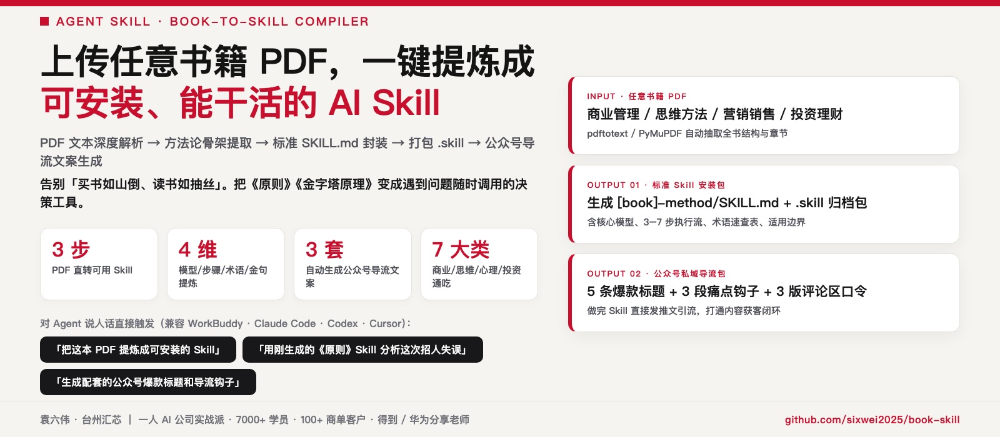
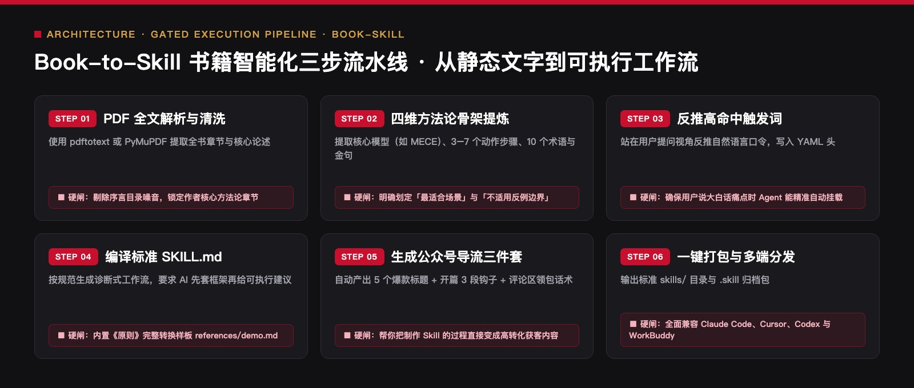

<div align="center">



# Book-to-Skill · 图书方法论编译器
### `book-skill` · 把任意专业书籍 PDF 编译成可复用 Agent `.skill` 技能包 + 公众号私域引流文案

[](https://agentskills.io)
[](#三三步编译流水线从-300-页书到可执行协议)
[](#五配套产出公众号私域引流三件套)
[](LICENSE)

> 🔴 **作者：袁六伟 · 台州汇芯**｜一人 AI 公司创业者，学员 7000+，客户 100+，得到 / 华为分享老师  
> 📮 更多 AI 工具实测与自动化实战，关注 **公众号 / 视频号：袁六伟**

**别再让 300 页的好书在网盘里吃灰——把它编译成一个随叫随到的 AI 专家顾问。**  
传统的「AI 读 PDF」只是给你写一篇千篇一律的读书摘要，看完照样不会用；`book-to-skill` 是一个 **元技能编译器（Meta-Skill Compiler）**：它自动抽干书中的水词故事，把作者的核心框架蒸馏成 **4D 执行协议（诊断问题 → 分步计算/推演 → 交付模板 → 避坑红线）**，一键打包为标准 `.skill` 文件，并同步生成一套高转化的 **公众号免费领 Skill 导流文案**。

```bash
# 方式 A：通过 skills CLI 一键安装（推荐）
npx skills add sixwei2025/book-skill

# 方式 B：克隆仓库并安装到 Claude Code / WorkBuddy
git clone https://github.com/sixwei2025/book-skill.git
cp -R book-skill/skills/book-to-skill ~/.claude/skills/
```

[读书摘要 vs 方法论编译](#一传统读书摘要-vs-book-to-skill-方法论编译) · [快速使用](#二一句话快速使用) · [三步编译流水线](#三三步编译流水线从-300-页书到可执行协议) · [7 大适配书类](#四7-大高价值书籍编译映射表) · [公众号导流三件套](#五配套产出公众号私域引流三件套)

</div>

## 新手安装：把链接发给 AI

打开 Codex、WorkBuddy，或其他支持技能安装的 AI 智能体，把下面这段话直接发到对话框，让它帮你安装：

```text
帮我安装这个仓库里的技能：
https://github.com/sixwei2025/book-skill
```

不需要自己先敲安装命令，按 AI 的提示完成即可。安装后可以接着问：“这个技能怎么用？带我做一个最简单的例子。”

需要使用能够读取仓库、操作本地文件并支持技能安装的 AI；如果当前平台不支持，它可以提供手动安装指引。部分技能还需要额外软件或账号配置，安装技能与完成这些配置是两步，按本页说明和 AI 提示继续。


---

## 一、传统读书摘要 vs `book-to-skill` 方法论编译

| 维度 | 普通 AI「帮我总结这本书」 | `book-to-skill` 图书方法论编译器 |
| :--- | :--- | :--- |
| **产出形态** | 一篇静态的章节概要，读完就忘 | 一个可挂载到 Claude / WorkBuddy 的交互式 `.skill` 专家代理 |
| **信息密度** | 混杂大量名人轶事、励志鸡汤、凑字数案例 | 只保留 **判断公式、决策树、检查清单、正反对照表** |
| **使用方式** | 人去回忆书里怎么说的 | 把你的真实业务数据丢进去，Skill 按原书公式帮你一步步算 |
| **商业变现** | 很难直接用来做私域钩子 | 自动附赠 **公众号爆款标题 × 5 + 痛点导流正文 + 评论区暗号引导** |

---

## 二、一句话快速使用

| 你对 Agent 说的话 | 自动执行的编译动作 |
| :--- | :--- |
| `把这个《精益数据分析.pdf》做成 Skill` | 提取全书目录与核心章节 → 提炼指标诊断树 → 生成 `lean-analytics.skill` + 公众号导流文案 |
| `帮我把这本《金字塔原理》提炼成一个帮你改汇报稿的 Skill，并写好 GitHub README` | 生成结构化 `SKILL.md` + `references/github-readme-template.md` 开源详情页 |
| `我没有 PDF，只有这篇 5000 字的《纳瓦尔宝典》读书笔记，能做成 Skill 吗？` | 直接基于长笔记提炼杠杆决策模型，补齐触发条件与输出模板后打包 |

---

## 三、三步编译流水线：从 300 页书到可执行协议

<p align="center">
  
</p>

### Step 1 · 智能分层解析（拒绝暴力截断前 20 页）
- 自动调用 `pdftotext` 或 `PyMuPDF (fitz)` 提取文本：
  - **第一刀抓骨架**：提取全书目录（TOC）、序言、每章开头导读与章末小结。
  - **第二刀抓图表与公式**：定向检索带有「步骤 / 原则 / 公式 / 清单 / 矩阵 / 模型 / 误区」的高密度段落。
  - **第三刀剔除噪音**：过滤长篇煽情故事、致谢、出版前言与重复车轱辘话。

### Step 2 · 4D 方法论骨架重构
将原书内容重写为 Agent 听得懂、执行得了的 **4D 结构**：
1. **Trigger（触发锚点）**：用户在什么真实痛点下应该唤醒这本书？
2. **Diagnostic（前置追问）**：动手前必须先向用户收集哪 3 个关键变量？（拒绝盲目给假大空建议）
3. **Workflow（分步推演引擎）**：Step 1 → Step N 的明确计算或改写规则，每一步都有原书理论锚点。
4. **Checklist & Anti-Patterns（交付模板与红线）**：固定 Markdown 交付表格 + 原书作者最反对的 5 个典型错法。

### Step 3 · 双产物打包交付
- **产物 1**：标准目录结构 `<book-slug>/SKILL.md` 及打包好的 `<book-slug>.skill`（ZIP 归档格式，可直接拖拽进支持 Agent Skills 的客户端）。
- **产物 2**：配套公众号私域裂变文案（见第五节）。

---

## 四、7 大高价值书籍编译映射表

| 书籍类型 | 代表作举例 | 编译后的 Skill 变成什么工具？ |
| :--- | :--- | :--- |
| **商业与增长** | 《精益创业》《跨越鸿沟》《定位》 | 新业务冷启动诊断器、竞品差异化定位生成器 |
| **写作与表达** | 《金字塔原理》《风格感觉》《故事》 | 向上汇报重构器、公文除草机、短视频故事弧线教练 |
| **谈判与沟通** | 《非暴力沟通》《掌控谈话》《关键对话》 | 高难度客户催款/加价谈判沙盘陪练、冲突话术改写器 |
| **心理学与认知** | 《思考，快与慢》《影响力》《福格行为模型》 | 产品促活上瘾机制设计器、消费决策偏差审计员 |
| **理财与投资** | 《穷查理宝典》《聪明的投资者》 | 多元思维模型检查清单、商业模式护城河质询官 |
| **研发与架构** | 《重构》《领域驱动设计》《代码整洁之道》 | 坏味道代码审查官、DDD 限界上下文拆分助手 |
| **个人效率** | 《搞定 GTD》《深度工作》《原子习惯》 | 周计划颗粒度拆解器、习惯阻力诊断工具 |

---

## 五、配套产出：公众号私域引流三件套

每次把一本书编译成 `.skill` 后，本技能会自动为你生成一套 **「把书变成 AI 员工免费送」** 的公众号引流钩子文案（详见 [`skills/book-to-skill/references/demo.md`](skills/book-to-skill/references/demo.md)）：

1. **5 条爆款备选标题**：主打「我把某本神书喂给 AI，做成了一个自动帮你干活的插件」。
2. **3 段式短平快导流正文**：
   - 第 1 段：戳中「买书如山倒、看完不会用」的普遍痛点；
   - 第 2 段：展示把这本书做成 `.skill` 前后的实战效果对比（附真实输入输出截图位）；
   - 第 3 段：零门槛安装教程（30 秒装进 Claude / WorkBuddy）。
3. **3 条评论区留存暗号话术**：引导读者关注并在后台/评论区回复关键词（如 `回复【定位】领 Skill 安装包`），高效沉淀精准私域用户。

---

## 六、仓库目录结构

```text
book-skill/
├── README.md                                        # 仓库总览与编译协议说明
├── book-to-skill.skill                              # 打包好的预编译 .skill 安装包
├── skills/
│   └── book-to-skill/
│       ├── SKILL.md                                 # 图书方法论编译器主协议
│       └── references/
│           ├── demo.md                              # 真实书籍编译案例与公众号导流文案示范
│           └── github-readme-template.md            # 生成新书 Skill 仓库时的 README 模板
└── assets/showcase/                                 # 首屏横幅与三步编译架构图
```

---

## 关于作者与开源生态

**袁六伟 · 台州汇芯**：一人 AI 公司创业者，学员 7000+，服务商单客户 100+，覆盖近 20 个行业，得到 / 华为分享老师。AI 变现实战派，自己跑通才拿出来教。

- 公众号：**袁六伟**（微信搜一搜关注，看更多 AI 工具实测与一人公司实战）
- 视频号：**袁六伟**

这个项目免费开源。如果它帮你的产线省下了每天反复返工的时间，欢迎在右上角点个 ⭐ **Star**，也欢迎转发给身边做内容或一人公司的朋友。

### 同系列开源 Skill 矩阵（袁六伟 · 台州汇芯）

| 仓库 | 领域 | 核心能力 |
| :--- | :--- | :--- |
| [**workbuddy-wechat-autopilot**](https://github.com/sixwei2025/workbuddy-wechat-autopilot) | 公众号全链路 | 九步全自动总控：选题→写稿→真实截图→6套封面→6套排版→三重自动质检→草稿箱 |
| [**wechat-cover-skill**](https://github.com/sixwei2025/wechat-cover-skill) | 公众号视觉 | 封面渲染引擎（6套高客单价杂志风 + 黑红金 v2b + 防压脸自动校验） |
| [**gzh-million-layout-skill**](https://github.com/sixwei2025/gzh-million-layout-skill) | 公众号排版 | 汇芯红 `#C8102E` 六套 100% 内联 CSS 骨架 + 零乱码检查 + 配图皮肤 |
| [**ai-tool-review-wechat-skill**](https://github.com/sixwei2025/ai-tool-review-wechat-skill) | 公众号评测 | AI 工具真跑评测工作流（2.0 全自动压测 + 去碎句语感质检 + 六套骨架装配） |
| [**hit-title-expert-skill**](https://github.com/sixwei2025/hit-title-expert-skill) | 爆款标题 | 一次直出 10 条 14–22 字高浓缩狠标题（5大公式 × 5类钩子词） |
| [**auto-tutorial-skill**](https://github.com/sixwei2025/auto-tutorial-skill) | 短视频工程 | 链接/网页/真机截图 → 3:4 封面 + 1.5x 配音 + 红框标注教程视频 |
| [**talking-head-video-skill**](https://github.com/sixwei2025/talking-head-video-skill) | 短视频工程 | 1080×1920 竖屏真人口播短视频（ASR 错字校对 + 逐字卡拉OK字幕 + 6项QC） |
| [**3d-map-video-skill**](https://github.com/sixwei2025/3d-map-video-skill) | 短视频工程 | MapLibre 3D 地形 + WarFX 战争特效（粒子行军/点阵兵力/震屏混音） |
| [**psych-kepu-video-skill**](https://github.com/sixwei2025/psych-kepu-video-skill) | 短视频工程 | Remotion + JSON 驱动的 15–30s 深色扁平动画心理科普短视频 |
| [**dark-infographic-video-skill**](https://github.com/sixwei2025/dark-infographic-video-skill) | 短视频工程 | 纯 Python + FFmpeg 暗黑流光数据可视化科普片（含 v2 手机外放配乐） |
| [**local-video-hub**](https://github.com/sixwei2025/local-video-hub) | AI 团队基建 | 视频版本地 Obsidian：多 AI 员工统一交片、撞题查重与四态流转云台 |
| [**yuanliuwei-ai-skills**](https://github.com/sixwei2025/yuanliuwei-ai-skills) | 一人公司方法 | PACT 72h 需求验证模型与一人 AI 公司 10 大业务决策模块 |
| [**book-skill**](https://github.com/sixwei2025/book-skill) | 知识工程 | 上传任意书籍 PDF → 自动提炼方法论生成 `.skill` + 公众号导流文案 |
| [**huangdi-skill**](https://github.com/sixwei2025/huangdi-skill) | 认知操作系统 | 中国历史八大皇帝（秦始皇/汉武帝/唐太宗等）一手史料认知框架蒸馏 |
| [**sunrise-tracker**](https://github.com/sixwei2025/sunrise-tracker) | 选题雷达 | 小红书 AI 赛道 10 倍异常流量「低粉爆文」每日早 7 点监测推送 |
